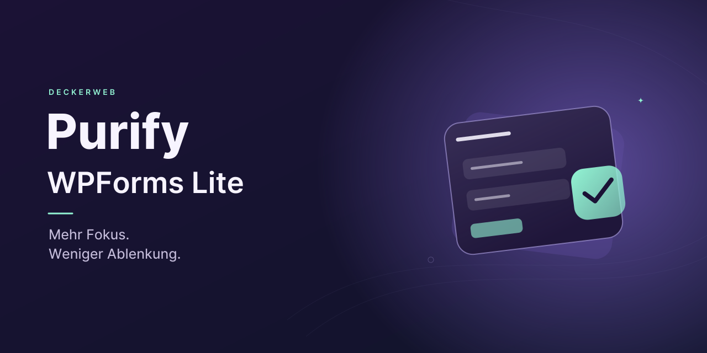

# Purify WPForms Lite

## Kurzvorstellung

Entfernt bekannte Werbeelemente aus WPForms Lite und erhält nützliche Funktionen der kostenlosen Version.

Version **1.1.0** · WordPress **6.7+** · PHP **8.0+** · GPL v2 or later

[English](README.md) · [FAQ](docs/FAQ.de.md)

## Inhaltsverzeichnis

[Auf einen Blick](#auf-einen-blick) · [Installation](#installation) · [Gezielte Bereinigung](#gezielte-bereinigung) · [Voraussetzungen und Grenzen](#voraussetzungen-und-grenzen) · [Häufige Fragen](#häufige-fragen) · [Änderungsverlauf](#änderungsverlauf) · [Autor und Projekt](#autor-und-projekt) · [Meldungen und Unterstützung](#meldungen-und-unterstützung)

## Auf einen Blick

- Geprüfte Bereinigung für WPForms Lite 1.9.4.2 und 2.0.2.2.
- Erhält kostenlose Felder, Vorlagen, Formular-Import/-Export und verfügbare Zahlungsfunktionen; Lite 2.0.2.2 enthält Stripe, PayPal Commerce und Square.
- Entfernt Einträge, Einrichtungs-Checkliste, Gutschein-Upsells und Fremdplugin-Werbung aus der Navigation.
- Plugin-Fassung mit deckerweb-Katalog, GitHub-Updater und lokalem Änderungsverlauf.
- Separate Snippet-Importe für Code Snippets/Advanced Scripts und WPCode Lite/Pro.

## Installation

1. Installiere das ZIP unter Plugins → Installieren → Plugin hochladen.
2. Aktiviere WPForms Lite und Purify. Prüfe den Status in der Pluginliste.
3. Alternativ importiere genau eine passende Snippet-JSON. Plugin und Snippet nicht parallel aktivieren.

## Gezielte Bereinigung

Entfernt bekannte Werbemenüs, den Upgrade-Link in der Toolbar, Pro-Vorlagen und benannte Premium-Werbebereiche. Formulare, kostenlose Felder, Zahlungen, Sicherungen, Einstellungen und notwendige Hinweise bleiben erhalten. Eintrags- und Gutschein-Upsells, Checkliste, fremde Pluginwerbung und unnötige Dashboardkarten werden gezielt entfernt. Die Bereinigung verändert keine gespeicherten WPForms-Daten.

## Voraussetzungen und Grenzen

PHP 8.0 ist gegenüber 1.0.0 neu erforderlich. WordPress 6.7 bleibt die Mindestversion. Eingebettet: Library 0.8.1 und Updater 2.1.0. Andere WPForms-Versionen werden vorsichtig ausgelassen. ClassicPress und echte GitHub-Updatezustellung dieses unveröffentlichten Standes sind nicht bestätigt. Banner und Icons verwenden eine eigenständige Formulargrafik.

## Häufige Fragen

### Schaltet Purify Pro-Funktionen frei?

Nein. Premium-Funktionen bleiben nicht verfügbar. Purify entfernt nur bekannte Werbeelemente.

### Welche Versionen werden unterstützt?

Die Bereinigung arbeitet mit WPForms Lite 1.9.4.2 und 2.0.2.2. Bei unbekannten Versionen, fehlendem WPForms und WPForms Pro pausiert sie. Die Pluginliste erklärt den Status.

### Wo sind die Einstellungen?

Die Bereinigung erfolgt automatisch. Purify fügt keine eigene Einstellungsseite hinzu. WPForms-Einstellungen und Lite-Connect-Sicherungen bleiben erreichbar. Der Fortschritt der Checkliste bleibt erhalten; ihr Menüpunkt und automatische Einrichtungsweiterleitungen werden ausgeblendet. Eintrags-Import/-Export, Eintrags-Automatisierung und die KI/MCP-Werbeansichten entfallen; vorhandene Einstellungen bleiben unverändert.

### Ändert Purify Formulare oder Hinweise?

Formulardaten und WPForms-Einstellungen werden nicht verändert. Benachrichtigungen, Fehler-/Sicherheitshinweise und tatsächliche Zahlungsgebühren bleiben sichtbar. WPConsent-Installationen über WPForms werden blockiert; die native manuelle Installation bleibt möglich. Purify entfernt keine installierten Plugins und aktiviert oder deaktiviert weder Lite Connect noch vorhandene KI-Zugriffseinstellungen.

### Kann ich ein Snippet verwenden?

Ja. Importiere die Code-Snippets-JSON in Code Snippets oder Advanced Scripts beziehungsweise die separate WPCode-JSON in WPCode Lite/Pro. Verwende nur eine Fassung gleichzeitig. Snippets enthalten die Bereinigung ohne gemeinsamen Katalog, Updater und Plugin-Änderungsverlauf.

### Funktioniert Multisite und was passiert bei der Deinstallation?

Die Bereinigung gilt für die aktuelle Website. Netzwerkaktivierung wird unterstützt. Purify speichert keine Formulardaten oder Bereinigungseinstellungen. Deaktivierung erhält Daten; die Deinstallation bereinigt temporäre Library-Daten erst nach Entfernung ihres letzten Hosts. Gemeinsame Einstellungen bleiben erhalten, sofern die separate Library-Löschoption nicht aktiviert wurde. WPForms-Daten werden niemals gelöscht.

### Welche externen Verbindungen gibt es?

Der Plugin-Updater prüft GitHub über WordPress-Updateabfragen. Der optionale Onlineabruf der Library ist zunächst ausgeschaltet und kontaktiert erst nach Aktivierung den freigegebenen GitHub-Katalog. Manuell angestoßene Kataloginstallationen laden freigegebene Pakete. Purify ergänzt keine Telemetrie. Snippets ergänzen keine externen Abrufe.

[Vollständige Fragen nach Themen](docs/FAQ.de.md)

## Änderungsverlauf

### 1.1.0 · 2026-10-10

- **Neu:** Gemeinsamer Katalog, GitHub-Updater und zugänglicher lokaler Änderungsverlauf.
- **Verbessert:** Gründlichere Bereinigung entfernt Premium-Eintragswerkzeuge, Gutschein-Upsells, Einrichtungs-Checkliste, WPVibe-/WPCode-Werbung und Werbe-Widgets; nutzbare Lite-Bedienelemente bleiben erhalten.
- **Verbessert:** Eigenständige lokalisierte Banner und Icons verwenden eine klare Formulargrafik.
- **Behoben:** Unbekannte Zielversionen pausieren sicher; mitgelieferte deutsche Übersetzungen werden geladen.
- **Sonstiges:** PHP 8.0 ist jetzt erforderlich. Newsletterlinks enthalten keine persönlichen Kontodaten. Snippet-Importe bleiben verfügbar.

### 1.0.0 · 2025-04-05

- **Neu:** Erste öffentliche Veröffentlichung.

## Autor und Projekt

David Decker – DECKERWEB. Purify konzentriert sich auf die kostenlose WPForms-Oberfläche. Vertrieb über GitHub; keine WordPress.org-Veröffentlichung.

## Meldungen und Unterstützung

[Issues](https://github.com/deckerweb/purify-wpforms-lite/issues) · [Security](SECURITY.md)

[Ko-fi](https://ko-fi.com/deckerweb) · [Buy Me a Coffee](https://buymeacoffee.com/daveshine) · [PayPal](https://paypal.me/deckerweb) · [Newsletter](https://eepurl.com/gbAUUn)

Copyright © 2022–2026 David Decker – DECKERWEB. GPL-2.0-or-later. [Third-party origins](THIRD-PARTY.md).
