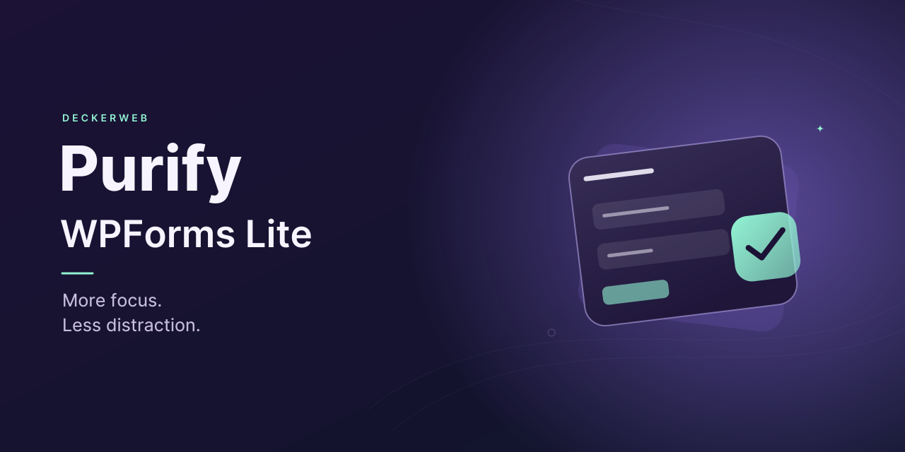

# Purify WPForms Lite

## About

Remove known promotional elements from WPForms Lite while keeping useful free features accessible.

Version **1.1.0** · WordPress **6.7+** · PHP **8.0+** · GPL v2 or later

[Deutsch](README.de.md) · [FAQ](docs/FAQ.en.md)

## Contents

[At a glance](#at-a-glance) · [Installation](#installation) · [Targeted cleanup](#targeted-cleanup) · [Requirements and limits](#requirements-and-limits) · [Frequently asked questions](#frequently-asked-questions) · [Changelog](#changelog) · [Author and project](#author-and-project) · [Reporting and support](#reporting-and-support)

## At a glance

- Audited cleanup for WPForms Lite 1.9.4.2 and 2.0.2.2.
- Keeps free fields, templates, form import/export and available payment controls; Lite 2.0.2.2 includes Stripe, PayPal Commerce and Square.
- Removes entries, setup checklist, coupon upsells and cross-product advertising from navigation.
- Plugin edition includes the deckerweb catalog, GitHub updater and local changelog.
- Separate snippet imports for Code Snippets/Advanced Scripts and WPCode Lite/Pro.

## Installation

1. Install the ZIP under Plugins → Add New → Upload Plugin.
2. Activate WPForms Lite and Purify. Check the status on the Plugins page.
3. Alternatively import one matching snippet JSON. Do not activate the plugin and a duplicate snippet together.

## Targeted cleanup

Removes known promotional menus, the toolbar upgrade link, Pro templates and named premium promotion areas. Forms, free fields, payments, backups, settings and operational notices remain. Entry and coupon upsells, checklist navigation, cross-plugin promotion and unnecessary dashboard cards are removed selectively. Cleanup does not modify saved WPForms data.

## Requirements and limits

PHP 8.0 is newly required compared with 1.0.0. WordPress 6.7 remains the minimum. Embedded components: Library 0.8.1 and Updater 2.1.0. Other WPForms releases are skipped conservatively. ClassicPress and real GitHub update delivery of this unpublished build are not verified. Banners and icons use an original form illustration.

## Frequently asked questions

### Does it unlock Pro features?

No. Premium features remain unavailable. Purify only removes known promotional elements.

### Which versions are supported?

Cleanup runs with WPForms Lite 1.9.4.2 and 2.0.2.2. Unknown versions, missing WPForms and WPForms Pro pause cleanup. The plugin list explains the status.

### Where are the settings?

Cleanup is automatic. Purify adds no separate settings page. WPForms settings and Lite Connect backup controls remain accessible. Checklist progress is preserved; its menu entry and automatic onboarding are hidden. Entry transfer/automation and AI/MCP promotional views are omitted; existing settings are unchanged.

### Does it change forms or notices?

No form data or WPForms settings are changed. Notifications, errors, security notices and real payment-fee disclosures remain. WPConsent installation through WPForms is blocked; native manual installation remains available. Purify does not remove installed plugins or enable/disable Lite Connect or existing AI access settings.

### Can I use a snippet?

Yes. Import the Code Snippets JSON in Code Snippets or Advanced Scripts, or the separate WPCode JSON in WPCode Lite/Pro. Run one edition only. Snippets contain cleanup without the shared catalog, updater or plugin-history dialog.

### Does it support Multisite and what happens on uninstall?

Cleanup follows the current website. Network activation is supported. Purify stores no form content or cleanup settings. Deactivation preserves data; uninstall cleans shared temporary Library data only after its final host is removed. Shared settings remain unless the separate Library deletion option was enabled. WPForms data is never deleted.

### What external connections are used?

The plugin updater checks GitHub through WordPress update checks. Optional Library online refresh is initially off and contacts the approved GitHub catalog only when enabled. User-triggered catalog installation downloads approved packages. Purify adds no telemetry. Snippets add no external requests.

[Full FAQ by topic](docs/FAQ.en.md)

## Changelog

### 1.1.0 · 2026-10-10

- **New:** Shared catalog, GitHub release updater and accessible local changelog.
- **Improved:** More thorough cleanup removes premium entry tools, coupon upsells, setup checklist links, WPVibe/WPCode promotion and advertising widgets while preserving usable Lite controls.
- **Improved:** Original localized banners and icons use a clear form illustration.
- **Fixed:** Unknown target versions pause cleanup safely and bundled German translations load.
- **Misc:** PHP 8.0 is now required. Newsletter links contain no personal account data. Snippet imports remain available.

### 1.0.0 · 2025-04-05

- **New:** Initial public release.

## Author and project

David Decker – DECKERWEB. Purify focuses on the free WPForms interface. Distribution through GitHub; no WordPress.org release.

## Reporting and support

[Issues](https://github.com/deckerweb/purify-wpforms-lite/issues) · [Security](SECURITY.md)

[Ko-fi](https://ko-fi.com/deckerweb) · [Buy Me a Coffee](https://buymeacoffee.com/daveshine) · [PayPal](https://paypal.me/deckerweb) · [Newsletter](https://eepurl.com/gbAUUn)

Copyright © 2022–2026 David Decker – DECKERWEB. GPL-2.0-or-later. [Third-party origins](THIRD-PARTY.md).
